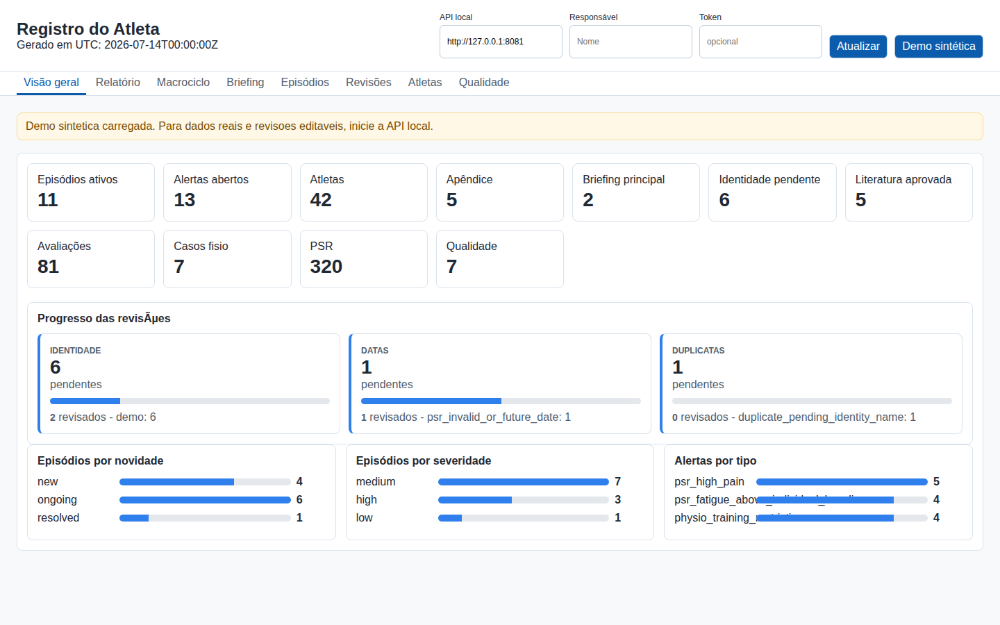

# Registro do Atleta

Projeto local para organizar fontes esportivas em um registro longitudinal, auditável e revisável dos atletas.

A base preserva as fontes originais, normaliza os dados por domínio e permite revisar identidades, datas, possíveis duplicidades e alertas. Também gera relatórios e opera localmente em SQLite.

> Esta edição pública contém apenas código e dados sintéticos de demonstração. Planilhas, bancos, snapshots, nomes de atletas, credenciais e configurações reais não fazem parte do repositório.

## Demonstração

Requer Python 3.12 ou superior.

No Windows:

```powershell
powershell -ExecutionPolicy Bypass -File scripts/start_demo.ps1
```

No Linux ou macOS:

```bash
sh scripts/start_demo.sh
```

Abra `http://127.0.0.1:8080` e selecione **Demo sintética**. A demonstração é somente leitura e usa personagens e indicadores fictícios.



Captura da demonstração de leitura; nenhum dado pessoal real é exibido.

Também é possível servir o dashboard diretamente:

```bash
python -m http.server 8080 --bind 127.0.0.1 --directory apps/dashboard
```

## O que está implementado

- Inventário e hash SHA-256 de fontes históricas, sem alterar os arquivos brutos.
- Snapshots e staging idempotente em SQLite.
- Cadastro longitudinal e resolução auditável de identidade.
- Normalização de PSR, fisioterapia e avaliações físicas.
- Verificações de qualidade, datas efetivas e possíveis duplicidades.
- Alertas determinísticos, episódios e briefings baseados em mudanças.
- Filas de revisão humana para identidades, datas, duplicidades, alertas e literatura.
- API local em FastAPI e dashboard responsivo.
- Backup, restauração verificada, lock de processo e relatórios operacionais.
- Integração opcional com LLM, desativada por padrão e sem autoridade sobre a persistência crítica.
- Gate metodológico antes de análises estatísticas avançadas.

## Arquitetura

```text
fontes brutas (somente leitura)
          |
          v
 snapshots + staging SQLite
          |
          v
 identidade auditável ----> revisão humana
          |
          v
 domínios normalizados ----> qualidade e duplicidades
          |
          v
 alertas determinísticos -> episódios -> briefing
          |
          +---------------> API local -> dashboard
```

Consulte [docs/ARCHITECTURE.md](docs/ARCHITECTURE.md) para mais detalhes.

## Instalar e testar

```bash
python -m venv .venv
# Windows: .venv\Scripts\activate
# Linux/macOS: source .venv/bin/activate
python -m pip install --upgrade pip
pip install -e ".[dev,api]"
python -m pytest -q
```

A API também pode iniciar com um banco local vazio:

```bash
registro-do-atleta run-api --database data/database/registro_atleta.db
```

Depois, acesse `http://127.0.0.1:8000/dashboard/`. Para usar dados reais, configure as fontes e leia [docs/PRIVACIDADE_E_DADOS.md](docs/PRIVACIDADE_E_DADOS.md).

## Princípios do projeto

1. As fontes brutas são imutáveis.
2. A persistência crítica é determinística e auditável.
3. Decisões ambíguas passam por revisão humana.
4. O LLM pode resumir e explicar, mas não decide sozinho o que será registrado como fato.
5. Análises avançadas só ficam disponíveis depois da verificação de qualidade e metodologia.

## Estado do projeto

Este projeto está em desenvolvimento e é uma demonstração técnica. Não é um dispositivo médico nem uma ferramenta de decisão clínica. Limites e alertas de exemplo não devem ser usados como recomendação profissional.

## Licença

Distribuído sob a [Licença MIT](LICENSE). É permitido usar, copiar, modificar e redistribuir o código, inclusive em projetos comerciais, desde que o aviso de autoria e a licença sejam preservados.
